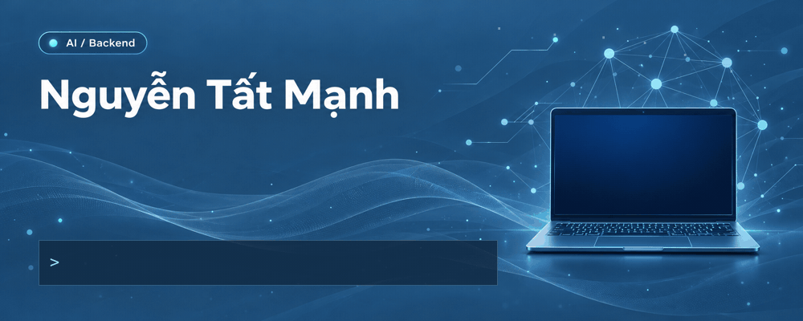
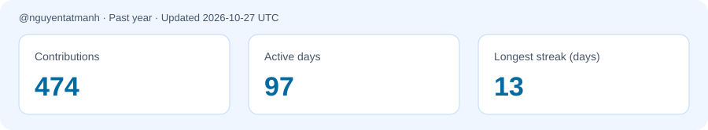

  

<h3 align="center">Passionate about AI & Backend Development</h3>

  Curious about AI. Passionate about Backend. Always learning.

  
  
  
  

---

## 👋 A little about me

I'm **Nguyễn Tất Mạnh**, a Computer Science student who is passionate about **Artificial Intelligence** and **Backend Development**.

I love exploring how backend systems work—from designing APIs and organizing application logic to understanding databases and system architecture. I enjoy experimenting with new technologies, asking questions, and turning what I learn into hands-on projects.

I'm also interested in connecting AI with backend services to build useful applications. I've used and explored technologies across backend development, web and mobile applications, machine learning, and computer vision, and I'm always looking for opportunities to learn more.

My goal is to grow as a **Backend & AI Engineer**, with a focus on clean code, reliable systems, and continuous learning.

| | About me |
| :--- | :--- |
| 📚 Field of study | Computer Science |
| 🎂 Birthday | September 19, 2005 |
| 📍 Current location | Hanoi, Vietnam |
| 🏡 Hometown | Nghe An, Vietnam |
| 🔎 Interests | Backend systems, AI, NLP, computer vision, and multi-agent RAG |
| 💡 Learning approach | Explore, experiment, build, and improve |

## 🛠️ Technologies I've used and explored

### Programming Languages

  
  
  
  
  
  
  

### Backend, Web & Mobile

  
  
  
  
  
  

### AI, Machine Learning & Data Science

  
  
  
  
  
  
  

### Database & Development Tools

  
  
  
  

**AI interests:** Machine Learning · Deep Learning · NLP · Computer Vision · LLM integration · Embeddings · RAG

## 🌱 What I'm learning

- Backend architecture, API design, and automated testing.
- Database design and working with MySQL.
- Machine Learning, Deep Learning, NLP, and Computer Vision.
- Retrieval quality and evaluation for RAG systems.
- Reliable integration of AI models into backend applications.

## 🐍 My contribution playground

  
  
  

  <picture>
    <source media="(prefers-color-scheme: dark)" srcset="assets/github-snake-dark.svg" />
    <source media="(prefers-color-scheme: light)" srcset="assets/github-snake.svg" />
    
  </picture>

  

A daily snapshot of my GitHub contribution activity, including private activity visible to my authenticated account. Contributions include commits, pull requests, issues, and reviews counted by GitHub.

## 🤝 Let's connect

- **Gmail:** [nguyentathuy2005@gmail.com](mailto:nguyentathuy2005@gmail.com)
- **iCloud:** [nguyenmanh2005hyhy@icloud.com](mailto:nguyenmanh2005hyhy@icloud.com)
- **Phone / Zalo:** 0384 222 614
- **Facebook:** [Nguyễn Tất Mạnh](https://www.facebook.com/nguyentatmanh199)
- **Instagram:** [@tatmanh199](https://www.instagram.com/tatmanh199/)

---

<i>Be yourself. Conquer yourself. Push beyond your limits.</i>

